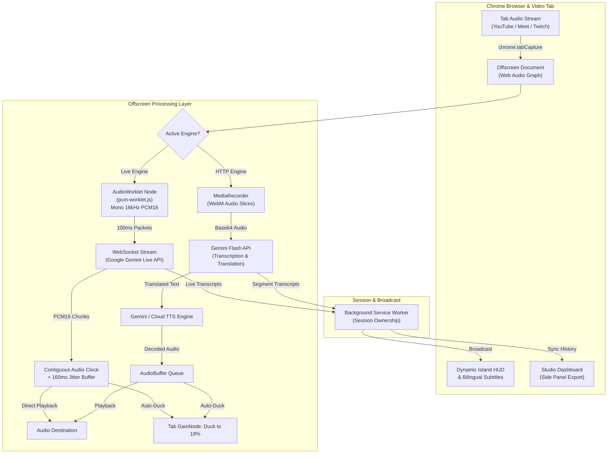

# Transora — Real-Time AI Video Dubbing & Neural Voice Streaming

<p align="center">
  
</p>

<p align="center">
  <strong>Next-generation Chrome extension delivering continuous, real-time multilingual AI video dubbing, ultra-low latency WebSocket neural voice streaming, and cinema-grade bilingual subtitles for any web video or live call.</strong>
</p>

<p align="center">
  
  
  
  
  
  
</p>

---

## ✨ Features

- **⚡ Continuous Gemini Live Streaming:** Direct real-time bidirectional WebSocket connection to Google Gemini Live API. Tab audio is continuously streamed in 100ms PCM16 packets and synthesized back with sub-second turnaround.
- **🏝️ Floating Dynamic Island HUD:** Sleek, glassmorphic HUD injected into video players via an isolated Shadow DOM. Features reactive neon audio visualizers, quick language selectors, and status badges.
- **🎧 Intelligent Audio Ducking:** Automatically ducks original tab audio by up to 82% with smooth exponential fades during translated speech, keeping background music and environmental sound intact. Includes a 300ms grace period to absorb short speech pauses.
- **💬 Cinema Bilingual Subtitles:** Floating, high-visibility subtitles displaying synchronized translated speech alongside the original transcript with auto-hiding during silence.
- **🎛️ Dual-Engine Architecture:** Toggle seamlessly between the ultra-fast **Gemini Live WebSocket Engine** and the structured **HTTP Segment Processing Engine**.
- **🔑 Privacy-First BYOK (Bring Your Own Key):** Zero proxy servers. Your Google API key is stored locally in `chrome.storage.local` and communicates directly with Google's endpoints.
- **📊 Studio Dashboard (Chrome Side Panel):** Complete transcript history, searchable dialogue logs, voice tuning (Female/Male), speed multipliers, and **one-click export to SRT & TXT**.
- **🌍 12+ Core Languages Supported:** Persian (فارسی), English, Spanish, French, German, Japanese, Chinese, Arabic, Turkish, Russian, Hindi, and Italian.

---

## ⚡ Dual Dubbing Engines

Transora offers two distinct dubbing architectures to match your workflow:

| Feature | ⚡ Gemini Live Streaming (Default) | 📦 HTTP Segment Pipeline |
| :--- | :--- | :--- |
| **Protocol** | Google Live WebSocket (`wss://`) | Google REST APIs (`generateContent`) |
| **Audio Capture** | Dedicated `AudioWorklet` (Mono 16kHz PCM16) | `MediaRecorder` (WebM Opus slices) |
| **Chunking** | Continuous 100ms realtime streaming packets | Configurable 1–8s audio segments |
| **Playback** | Contiguous audio clock + 160ms jitter buffer | Queued `AudioBufferSourceNode` playback |
| **Voice Synthesis** | Native Gemini Live PCM Audio Stream | Tiered: Gemini Flash TTS → Cloud TTS → Browser Voice |
| **Latency** | **Sub-second ultra-low latency (~300–600ms)** | Segment duration + processing (~1.5–3.5s) |
| **Best For** | Live YouTube streams, conferences, Google Meet | Lectures, structured videos, long pauses |

---

## 🏗️ Architecture & Pipeline

Transora adheres strictly to modern Chrome **Manifest V3** security constraints, orchestrating an **Offscreen Document** for Web Audio graphs and WebSockets while keeping background service workers lightweight and resilient:



---

## 🧠 Supported AI Models

### ⚡ Gemini Live Streaming Models (Default)
| Model Identifier | Latency | Capability | Best Use Case |
| :--- | :--- | :--- | :--- |
| **`gemini-3.5-live-translate`** *(Recommended)* | ⚡ Ultra-Fast (~300ms) | Dedicated live translation config | Instant real-time video dubbing |
| **`gemini-2.5-flash-native-audio`** | ⚡ Ultra-Fast (~350ms) | Low-latency audio-to-audio dialogue | Interactive calls and turn-taking |
| **`gemini-3.1-flash-live-preview`** | 🚀 Fast (~400ms) | Next-gen Live architecture | Conversational dialogue streams |
| **`gemini-3.8-live`** | 🧠 Standard (~550ms) | Deep contextual comprehension | Technical lectures & webinars |
| **`gemini-3.8-live-thinking`** | 🧠 Standard (~750ms) | Nuanced idioms & complex vocabulary | Specialized academic content |
| **`gemini-3.5-transcribe-live`** | ⚡ Ultra-Fast (~250ms) | Source-only transcription | Live subtitle generation without dubbing |

### 📦 HTTP Translation & Synthesis Models
| Component | Default Model | Fallback Models |
| :--- | :--- | :--- |
| **Translation Engine** | `gemini-flash-lite-latest` | `gemini-3.5-flash-lite`, `gemini-3.1-flash-lite` |
| **Voice Synthesis (TTS)** | `gemini-3.8-flash-lite-tts` | `gemini-3.1-flash-tts-preview`, Google Cloud TTS, Native Browser Speech |

---

## 🚀 Quick Start & Installation

### Requirements
- **Chrome 116** or newer (supports Side Panel, Offscreen Documents, and TabCapture MV3).
- **Node.js 22** or **Node.js 24+** (for building and running tests).

### 1. Build from Source

```bash
# Clone the repository
git clone git@github.com:amirhossein-mehdikhani/Transora.git
cd Transora

# Install exact dependencies
npm ci

# Run test suite
npm test

# Build production bundle
npm run build
```

This compiles the extension into the `dist/` directory.

### 2. Load into Chrome / Brave / Edge

1. Open your browser and go to `chrome://extensions/` (or `edge://extensions/` / `brave://extensions/`).
2. Toggle on **"Developer mode"** in the top right corner.
3. Click **"Load unpacked"**.
4. Select the **`dist`** folder inside the `Transora` workspace.
5. Click the puzzle icon and pin **Transora** to your Chrome toolbar!

> [!TIP]
> During development, run `npm run dev` to watch files across extension views, popups, and the injected content script.

---

## 🎮 How to Use

1. **Configure Your API Key (BYOK):**
   - Click the Transora icon in your Chrome toolbar or open the **Dashboard** side panel.
   - Enter your [Google AI Studio API Key](https://aistudio.google.com/app/apikey) and click **Save Key**.
2. **Grant Tab Audio Capture:**
   - Navigate to any video site (e.g. YouTube, Twitch, Coursera) or meeting (Google Meet).
   - Click the Transora toolbar icon once on that tab to grant active tab capture permission.
3. **Start Live Dubbing:**
   - Click **Start Live Dubbing** from the popup, side panel, or floating video HUD.
   - Or simply press the global hotkey: **`Alt + Shift + D`**.
4. **Enjoy Synced Dubbing & Subtitles:**
   - Transora smoothly ducks the original video volume, streaming the synthesized neural voice directly through your speakers while overlaying bilingual subtitles!
5. **Stop Session:**
   - Press **`Alt + Shift + D`** or click **Stop Live Dubbing**. Navigating away or closing the tab automatically cleans up the session.

---

## 🎛️ Modes of Operation

| Mode | Target Platforms | Behavior |
| :--- | :--- | :--- |
| **🎬 Video Player Mode** | YouTube, Twitch, Vimeo, Coursera, Twitter/X | Optimized for continuous viewing. Uses smooth volume ducking (18%), full-screen subtitle retention, and jitter buffer smoothing. |
| **📞 Live Call Mode** | Google Meet, Zoom Web, Microsoft Teams | Configured for high-cadence conversations. Caps chunk intervals at 1.5s with rapid turn-taking audio release. |

---

## 💾 State Management & Transcript Exports

- **Session Ownership:** The background Service Worker acts as the single source of truth for session state, preventing ghost audio sessions or desynced controls.
- **Audio Metering in Offscreen:** Chromium pauses `requestAnimationFrame` in hidden documents. Transora utilizes high-precision background timers (`setInterval`) to ensure metering and VAD never stall.
- **Bilingual Subtitle Overlay:** Automatically anchors to fullscreen player containers and gently fades out during silence.
- **One-Click Export:**
  - **SRT File:** Exports timestamped subtitle tracks aligned with the session media clock.
  - **TXT File:** Exports clean, readable conversational transcripts of the entire session history.
- **History Cache:** Stores up to 150 transcript items locally in `chrome.storage.local`.

---

## 🛡️ Privacy, Credentials & Security

> [!IMPORTANT]
> **100% Client-Side Privacy (BYOK):**
> Transora operates with zero intermediary proxy servers. Your API key is stored exclusively on your local machine via `chrome.storage.local`. All audio packets, transcriptions, and speech synthesis requests are transmitted directly between your browser and Google's official endpoints over encrypted HTTPS/WSS.

> [!NOTE]
> Chrome security policies strictly forbid capturing internal browser pages (`chrome://`, `chrome-extension://`, or the Chrome Web Store). Transora must be used on standard web pages (`http://` or `https://`).

---

## 📂 Project Structure

```
Transora/
├── public/
│   ├── manifest.json            # Chrome Manifest V3 configuration
│   ├── pcm-worklet.js           # AudioWorklet: mono mixing & 16kHz PCM16 resampler
│   └── icons/                   # High-res neon gradient brand icons (16, 48, 128)
├── src/
│   ├── background/
│   │   └── index.ts             # Service worker managing tabs, streams & session routing
│   ├── offscreen/
│   │   ├── index.html           # Dedicated offscreen host
│   │   └── index.ts             # Web Audio graph, Gain ducking & stream coordinator
│   ├── content/
│   │   ├── index.tsx            # Shadow DOM injection engine
│   │   ├── styles/content.css   # Scoped Tailwind styles
│   │   └── components/
│   │       ├── DynamicIslandHUD.tsx # Interactive floating video island
│   │       ├── SubtitleOverlay.tsx  # Dual-language live subtitle bar
│   │       └── AudioVisualizer.tsx  # Reactive soundwave visualizer
│   ├── popup/                   # Fast toolbar status popover
│   ├── sidepanel/               # Studio dashboard, transcript logs & key manager
│   ├── components/
│   │   └── LiveControls.tsx     # Shared engine & Live model selector component
│   ├── services/
│   │   ├── gemini-live-session.ts # Google Gemini Live WebSocket protocol & PCM player
│   │   ├── google-gemini-live.ts  # HTTP REST API connector & audio decoders
│   │   ├── live-playback.ts       # Contiguous audio clock & jitter buffer
│   │   ├── speech.ts              # Speech synthesis & browser fallback router
│   │   ├── session.ts             # Session timing & SRT/TXT exporter
│   │   └── storage.ts             # Settings persistence & auto-migration
│   └── types/                   # Unified TypeScript definitions & language maps
├── tests/                       # Automated regression test suite
├── vite.config.ts               # Multi-target Vite rollup builder
└── tailwind.config.js           # Transora glassmorphism palette & animations
```

---

## 📄 License

Distributed under the **MIT License**. Designed and engineered with precision for real-time multilingual AI video experiences.
