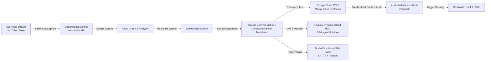

# Transora — Real-Time AI Video Dubbing & Neural Voice Streaming

<p align="center">
  
</p>

<p align="center">
  <strong>Next-generation Chrome extension that brings live voice-to-voice video dubbing, neural audio streaming, and cinema-grade bilingual subtitles to any web video or live call.</strong>
</p>

<p align="center">
  
  
  
  
</p>

---

## ✨ Features

- **⚡ Zero-Lag Live Dubbing:** Translates and speaks dialogue in real-time as you watch videos on YouTube, Twitch, Coursera, or participate in Google Meet and Zoom Web calls.
- **🏝️ Floating Dynamic Island HUD:** Sleek, glassmorphic HUD injected into video players via isolated Shadow DOM. Features real-time neon audio visualizers, quick language pickers, and latency badges.
- **🎧 Intelligent Audio Ducking:** Automatically dips the original tab audio by 80% with smooth exponential fades whenever the translated voice speaks, keeping background music and ambient sounds intact.
- **💬 Dual-Language Subtitles (Bilingual Overlay):** Floating cinematic subtitles displaying both the translated dialogue and the source transcript.
- **🔑 BYOK (Bring Your Own Key):** Completely private and client-side. Enter your own Google Gemini / Cloud API token—no third-party servers, zero data leakage.
- **📊 Studio Dashboard (Chrome Side Panel):** Full searchable transcript history, one-click **Export to SRT / TXT**, voice persona tuning (Female/Male), speed multiplier (0.8x - 1.4x), and key tester.
- **🌍 12+ Core Languages Supported:** Persian (Farsi), English, Spanish, French, German, Japanese, Chinese, Arabic, Turkish, Russian, Hindi, and Italian.

---

## 🏗️ Architecture & Pipeline

Transora complies with modern Chrome **Manifest V3** constraints using the **Offscreen Documents API** to run audio graphs outside of transient service workers:



---

## 🧠 Supported Google Gemini Models

Transora supports the entire modern Google Gemini API catalog with live auto-detection from your Google AI Studio project:

### 🟢 Free Tier Eligible Models ($0 Cost)
| Model Identifier | Latency | Context | Best Use Case |
| :--- | :--- | :--- | :--- |
| **`gemini-2.0-flash`** *(Recommended)* | ⚡ Ultra-Fast (~300ms) | 1M Tokens | Real-time live dubbing & streaming dialogue |
| **`gemini-2.0-flash-lite`** | ⚡ Ultra-Fast (~220ms) | 1M Tokens | High-frequency continuous speech & gaming streams |
| **`gemini-3.8-flash`** | 🚀 Fast (~450ms) | 1M Tokens | Next-gen reasoning & natural conversational flow |
| **`gemini-1.5-flash`** | 🚀 Fast (~500ms) | 1M Tokens | Stable workhorse for general video translation |
| **`gemini-1.5-flash-8b`** | ⚡ Ultra-Fast (~280ms) | 1M Tokens | Lightweight rapid turn-taking |

### 💎 Paid / Pro Tier Models (High Reasoning)
| Model Identifier | Latency | Context | Best Use Case |
| :--- | :--- | :--- | :--- |
| **`gemini-1.5-pro`** | 🧠 Standard (~850ms) | 2M Tokens | Cinematic nuance, complex idioms & literary accuracy |
| **`gemini-2.5-pro`** | 🧠 Standard (~900ms) | 2M Tokens | Technical lectures, multi-speaker debate, specialized terminology |
| **Custom Model ID** | Custom | Custom | Any fine-tuned or experimental Google AI Studio endpoint |

---

## 🛠️ Tech Stack

- **Framework:** React 18 + TypeScript + Vite
- **Styling:** Tailwind CSS + Glassmorphism + Lucide React Icons
- **Extension Platform:** Chrome Extension Manifest V3 (Service Worker, Offscreen API, Side Panel API, TabCapture API)
- **Audio Processing:** Web Audio API (`AudioContext`, `GainNode`, `AnalyserNode`)
- **AI Engines:**
  - Google Gemini 1.5 / 2.0 Flash (Streaming contextual translation)
  - Google Cloud Text-to-Speech (Neural2 / Studio / Journey voices)
  - Browser Speech Engine fallback

---

## 🚀 Quick Start & Installation

### 1. Build the Extension

Ensure you have **Node.js 18+** installed:

```bash
# Clone or navigate to the directory
cd Transora

# Install dependencies
npm install

# Build the production extension
npm run build
```

This compiles everything into the `/dist` directory.

### 2. Load into Chrome / Brave / Edge

1. Open your browser and navigate to `chrome://extensions/` (or `brave://extensions/`).
2. Toggle on **"Developer mode"** in the top right corner.
3. Click **"Load unpacked"**.
4. Select the **`dist`** folder inside this repository.
5. Pin **Transora** to your extension toolbar!

---

## 🔑 Obtaining your Google API Key (BYOK)

1. Go to [Google AI Studio](https://aistudio.google.com/app/apikey).
2. Sign in with your Google account.
3. Click **"Create API Key"**.
4. Click on the Transora extension icon or open the Side Panel, navigate to **Google AI (BYOK)**, and paste your key.
5. Click **"Test & Save Key"**. Once verified, you are ready to start dubbing!

---

## 🎛️ Modes of Operation

| Mode | Target Platforms | Behavior |
| :--- | :--- | :--- |
| **Video Player Mode** | YouTube, Twitch, Vimeo, Twitter/X, HTML5 Video | Injects HUD & Subtitles directly above video player, buffers audio for optimal cadence and cadence synchronization. |
| **Live Call Mode** | Google Meet, Microsoft Teams, Zoom Web | Optimized for low-latency live conversational dialogue with rapid turn-taking audio ducking. |

---

## 📂 Project Structure

```
Transora/
├── public/
│   ├── manifest.json            # Manifest V3 configuration
│   └── icons/                   # High-res neon gradient app icons
├── src/
│   ├── background/
│   │   └── index.ts             # Service worker managing tabs, streams & routing
│   ├── offscreen/
│   │   ├── index.html           # Dedicated offscreen host
│   │   └── index.ts             # Web Audio graph, Gain ducking & Speech queue
│   ├── content/
│   │   ├── index.tsx            # Shadow DOM injection engine
│   │   ├── styles/content.css   # Scoped Tailwind stylesheet
│   │   └── components/
│   │       ├── DynamicIslandHUD.tsx # Interactive floating video island
│   │       ├── SubtitleOverlay.tsx  # Dual-language live subtitle bar
│   │       └── AudioVisualizer.tsx  # Reactive soundwave visualizer
│   ├── popup/                   # Quick status popover
│   ├── sidepanel/               # Studio dashboard, transcript logs & key manager
│   ├── services/
│   │   ├── google-gemini-live.ts # Translation & TTS API connectors
│   │   └── storage.ts           # BYOK encryption and transcript cache
│   └── types/                   # Unified TypeScript interfaces
├── vite.config.ts               # Multi-target Vite rollup builder
└── tailwind.config.js           # Transora neon palette & animations
```

---

## 📄 License

MIT License © 2026 Transora. Designed and engineered for high-performance multilingual video streaming.

